# n8n on AKS - Postgres + Key Vault secrets + TLS via Let's Encrypt

Terraform provisions an AKS cluster (Cilium dataplane/network policy), a managed
Postgres Flexible Server, and an Azure Key Vault. n8n runs as a Deployment,
backed by Postgres, reachable only through a Traefik Ingress with a real
Let's Encrypt certificate - no direct public Service anymore. DB credentials
never live in plain YAML - they flow through Key Vault and the Secrets Store
CSI Driver into a Kubernetes Secret at deploy time.

## Infra (Terraform)

```bash
cp .env.example .env   # fill in subscription ID, db user/password, acme_email
make init
make plan
make apply
```

Outputs include `db_host`, `db_name`, `db_user`, `key_vault_name`,
`key_vault_uri`, and `kubectl_credentials_command` (run that one to
authenticate `kubectl`/`k9s` against the cluster).

## Secrets flow

How a value in `.env` ends up as an environment variable inside the n8n
container, without ever being written to a Kubernetes manifest in plaintext:

```mermaid
flowchart LR
    subgraph env_box[".env"]
        ENV["━━━━━━━━━━━━━━━━━━━━━━━━━━━<br/>TF_VAR_db_user=n8n-admin"]
    end

    subgraph tf_entry[Terraform]
        direction TB

        VAR["main.tf<br/>━━━━━━━━━━━━━━━━━━━━━━━━━━━<br/>variable db_user {<br/>&nbsp;&nbsp;type = string<br/>&nbsp;&nbsp;sensitive = true<br/>}"]
        PG["azurerm_postgresql_flexible_server<br/>administrator_login"]
        KVS["azurerm_key_vault_secret 'db-user'<br/>(lives in Azure Key Vault)"]
    end

    ENV --> VAR

    subgraph k8s[Kubernetes]
        direction TB

        SPC["secrets.yaml.tpl<br/>━━━━━━━━━━━━━━━━━━━━━━━━━━━<br/>apiVersion: secrets-store.csi.x-k8s.io/v1<br/>kind: SecretProviderClass<br/>metadata:<br/>&nbsp;&nbsp;name: n8n-secrets"]
        CSI["Secrets Store CSI Driver<br/>(DaemonSet, every AKS node)<br/>auths via AKS managed identity"]
        FILE["Volume mount:<br/>/mnt/secrets-store/db-user"]
        K8SSEC["secretObjects sync creates:<br/>Secret n8n-container-env"]
        ENVFROM["Pod envFrom.secretRef<br/>-> DB_POSTGRESDB_USER env var"]

        PG --> KVS --> SPC --> CSI
        CSI --> FILE
        CSI --> K8SSEC
        K8SSEC --> ENVFROM
        FILE -.->|"mounting the CSI volume is what<br/>triggers the fetch+sync at all"| K8SSEC
    end

    VAR --> PG

    FILE -.->|"mounting the CSI volume is what<br/>triggers the fetch+sync at all"| K8SSEC
```



Key things this diagram is making explicit:
- **Terraform never passes the secret to Kubernetes directly.** It creates the
  value in Azure Key Vault; Kubernetes pulls it from there independently, at
  pod-start time.
- **The CSI driver authenticates with a managed identity** (AKS's
  `key_vault_secrets_provider` addon), not a stored credential - `secrets.yaml.tpl`
  is rendered via Terraform's `templatefile()` so that identity's client ID is
  always current, even after a cluster destroy/recreate.
- **The env-var path depends on the file-mount path.** `secretObjects` only
  syncs into a real `Secret` object because *something* mounts the CSI volume -
  that mount is what triggers the fetch. No mount, no synced `Secret`, no
  `envFrom` values.

## Inspecting the secret at each stage

Commands matching each node in the diagram above - run top to bottom to see
the value transform from vault secret to running env var.

**The `SecretProviderClass` object itself:**
```bash
kubectl get secretproviderclass -n n8n
kubectl describe secretproviderclass n8n-secrets -n n8n
```

**The synced Kubernetes `Secret` (created by the CSI driver, not Terraform):**
```bash
kubectl get secret -n n8n
kubectl get secret n8n-container-env -n n8n -o yaml   # values are base64, not plaintext
```

**Decode an actual value** (careful - this prints the real secret to your terminal):
```bash
kubectl get secret n8n-container-env -n n8n -o jsonpath='{.data.DB_POSTGRESDB_USER}' | base64 -d
```

**The file-mount side** - same value, written as a plain file inside the pod:
```bash
kubectl exec -n n8n deploy/n8n -- ls -la /mnt/secrets-store
kubectl exec -n n8n deploy/n8n -- cat /mnt/secrets-store/db-user
```

**Confirm it actually landed as an env var in the running container:**
```bash
kubectl exec -n n8n deploy/n8n -- env | grep DB_POSTGRESDB
```

## TLS (Traefik + cert-manager + Let's Encrypt)

Three pieces, all wired through Terraform:

- `helm_release.traefik` - ingress controller, its Service is `type: LoadBalancer`
  (the one real public IP left in this stack)
- `helm_release.cert_manager` - installs the `Issuer`/`ClusterIssuer`/`Certificate`
  CRDs + the controller that talks to Let's Encrypt
- `kubectl_manifest.n8n_cluster_issuer` - two `ClusterIssuer` objects (staging + prod),
  rendered from `cluster-issuer.yaml.tpl` via `templatefile()` so the ACME contact
  email never gets hardcoded into a public repo

**DNS is the one thing Terraform doesn't manage, and it changes every `apply`.**
Traefik's `LoadBalancer` IP is dynamically allocated (no reserved `azurerm_public_ip`)
- after every `apply`:
1. `kubectl get svc -n traefik traefik` - grab the new `EXTERNAL-IP`
2. Update the domain's A record at your DNS provider to point there
3. If a local resolver (AdGuard, Pi-hole, etc.) has a wildcard rewrite covering the
   same zone, update/override that too - otherwise LAN devices resolve to whatever
   the wildcard catches instead of the real IP

Let's Encrypt's HTTP-01 challenge validates from the public internet, not from
your LAN - the DNS record has to be correct *before* a `Certificate` can issue,
regardless of local DNS state.

**Staging first, always.** `ingress.yaml`'s annotation defaults to
`letsencrypt-staging` - issues instantly but signed by an untrusted test root
(browser warning here is expected, not a bug). Once DNS/routing is confirmed
working end to end, switch the annotation to `letsencrypt-prod` and reapply.
Prod is rate-limited (~5 certs/week per exact domain); staging isn't - iterate
there first.

**Verifying without a browser** (sidesteps local DNS/cache noise entirely):
```bash
openssl s_client -connect <traefik-external-ip>:443 -servername aks.n8n.nicklab.org </dev/null 2>/dev/null \
  | openssl x509 -noout -issuer -subject -dates
```
`issuer=` containing `(STAGING)` = still the test CA. Clean `O=Let's Encrypt`
with no staging marker = real, browser-trusted cert.

```bash
kubectl get certificate -n n8n
kubectl describe certificate -n n8n   # Ready: True means issued successfully
```

## n8n (Kubernetes manifests)

```bash
$(terraform output -raw kubectl_credentials_command)
kubectl get svc -n traefik traefik   # grab EXTERNAL-IP, point DNS at it
```

Open `https://aks.n8n.nicklab.org` (or whatever host is set in `ingress.yaml`).
n8n no longer has a public Service of its own - everything routes through the
Ingress above.

- `manifests/namespace.yaml` - the `n8n` namespace
- `manifests/secrets.yaml.tpl` - `SecretProviderClass`, rendered by Terraform via `templatefile()`
- `manifests/configmap.yaml` - non-sensitive env vars (timezone, runner flags, `DB_POSTGRESDB_HOST`/`DB_POSTGRESDB_DATABASE`)
- `manifests/storage.yaml` - PVC using the cluster's default StorageClass
- `manifests/deployment.yaml` - n8n Deployment, non-root (UID 1000), PVC + CSI secrets volume mounted
- `manifests/service.yaml` - `ClusterIP` Service, internal only, reached via the Ingress
- `manifests/cluster-issuer.yaml.tpl` - staging + prod `ClusterIssuer` objects, rendered by Terraform
- `manifests/ingress.yaml` - Traefik `Ingress`, terminates TLS using the cert-manager-issued Secret

## Tests on cluster

Run top to bottom after every fresh `apply`. Each checks one real failure mode
seen while building this project, not generic box-ticking.

**Cluster health:**
```bash
kubectl get nodes
kubectl get pods -A
```
All nodes `Ready`, no pod `CrashLoopBackOff`/stuck `Pending` (n8n, traefik,
cert-manager, cainjector, webhook).

**Secrets:**
```bash
kubectl -n n8n get secrets 
```
2 secrets must be present:
- `n8n-container-env` -> synced DB credentials Secret, created by Secrets Store CSI Driver's secretObjects sync from `secrets.yaml.tpl's SecretProviderClass`
- `n8n-tls-prod-...` -> if you get the suffix something is off. This should be without fix `n8n-tls-prod` -> issued TLS certificate Secret created by cert-manager once the ACME `Order/Challenge` chain completes successfully. Type: `kubernetes.io/tls`, holds 2 keys:
```yaml
Data
====
tls.crt:  5663 bytes
tls.key:  1675 bytes
```

**troubleshoot n8n-tls-prod secret:** 
```bash
kubectl get certificate -n n8n -o wide
kubectl describe certificate -n n8n

kubectl get certificaterequest -n n8n -o wide
kubectl describe certificaterequest -n n8n

kubectl get order -n n8n -o wide
kubectl describe order -n n8n

kubectl get challenge -n n8n
``` 

The chain: `Certificate` -> `CertificateRequest` -> `Order` -> `Challenge`

`Challenge's Reason field` -> `failed to perform self check GET request ... context deadline exceeded` 

To resolve: update the new DNS public name to Cloudflare. 

Just wait or, delete the `Challenge object`, cert-manager recreates it immediately and retries:
```bash
kubectl delete challenge -n n8n --all 
kubectl -n n8n get secrets
```

**Secrets actually synced (Key Vault -> CSI -> env var):**
```bash
kubectl get secretproviderclass -n n8n
kubectl get secret n8n-container-env -n n8n
kubectl exec -n n8n deploy/n8n -- env | grep DB_POSTGRESDB
```
Real, non-empty values in the last command - not just the Secret existing.

**Postgres - actually reached, not silently falling back:**
```bash
kubectl logs -n n8n deploy/n8n   # no ECONNREFUSED / auth errors on startup
```

```bash
kubectl run psql-test --rm -it \
    --image=postgres:16 --restart=Never -n n8n -- psql \
    "host=$(terraform output -raw db_host) port=5432 dbname=n8n user=<db_user> password=<db_password> sslmode=disable"
```
Inside the psql session, `\dt` should list n8n's own tables (`workflow_entity`,
`credentials_entity`, etc.) - proof it's really on Postgres, not SQLite-on-PVC.

**TLS / certificate:**
```bash
kubectl get certificate -n n8n
kubectl describe certificate -n n8n   # Ready: True
openssl s_client -connect <traefik-external-ip>:443 -servername aks.n8n.nicklab.org </dev/null 2>/dev/null \
  | openssl x509 -noout -issuer -subject -dates
```
`issuer=` must show plain `O=Let's Encrypt` - no `(STAGING)` marker once
switched to `letsencrypt-prod`.

**End-to-end, real-world:**
```bash
curl -v https://aks.n8n.nicklab.org
```
`SSL certificate verify ok` + HTTP 200. Then confirm in an actual browser:
- from outside the LAN (mobile data, wifi off) - rules out any local DNS lie
- from inside the LAN (normal wifi) - confirms the AdGuard rewrite itself is correct
- in a private/incognito window too, if the normal profile cached a cert
  exception from an earlier staging attempt

**Backdoor check - confirms the direct-public-access path is gone:**
```bash
kubectl get svc -n n8n
```
`n8n-loadbalancer` must show `ClusterIP`, no `EXTERNAL-IP` - everything should
route through the Ingress only.

## Teardown

```bash
make destroy
```
